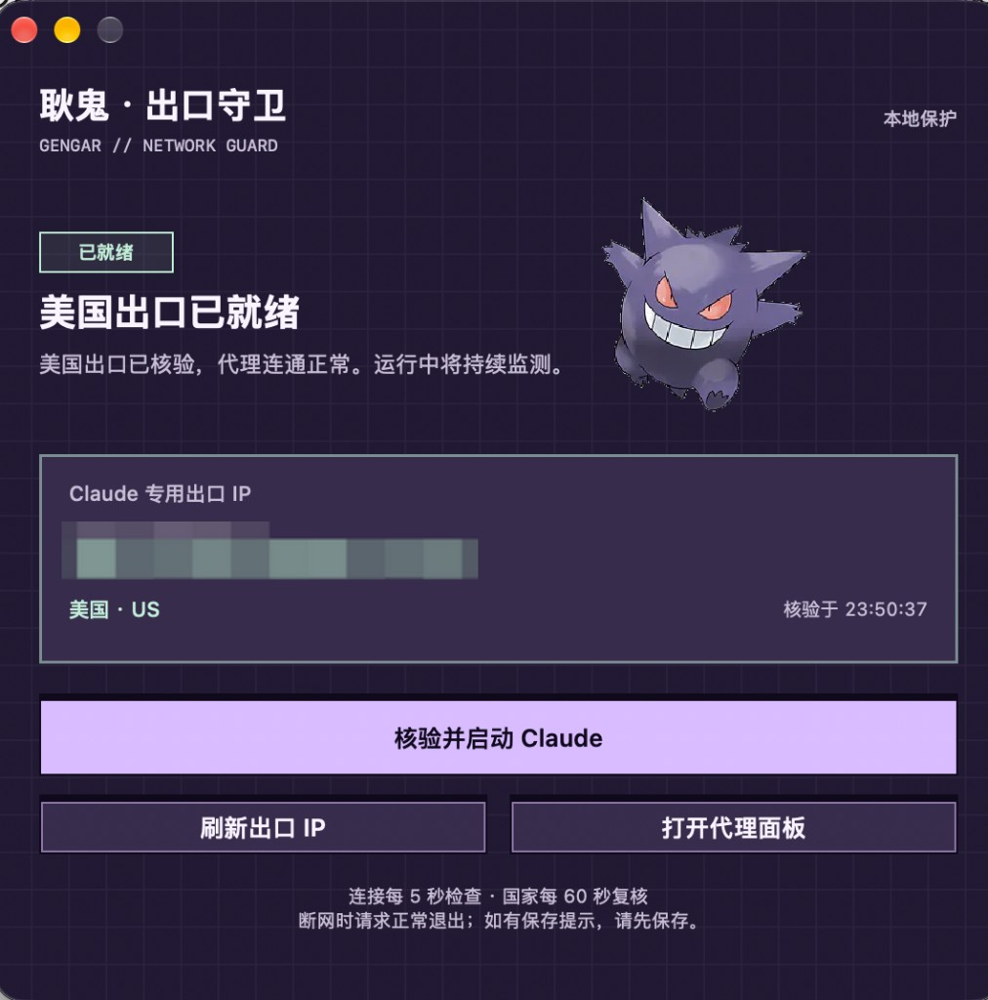

# Claude Proxy Guard · Claude 代理守卫

**先核验出口再启动，记录 IP 变化，确认代理异常时请求正常退出。**

专为 **macOS + Clash Verge (Mihomo)** 用户打造的零侵入菜单栏守卫（Fail-Closed Proxy Guard & Kill Switch）。无需 Root / TUN 权限，不篡改代理配置，纯原生 Swift + AppKit 构建。

<p align="center">
  
  <br />
  <sub>自定义立绘皮肤效果展示 · 开源默认内置原创紫色像素盾牌，放入 <code>assets/Mascot.png</code> 即可一秒换肤</sub>
</p>

---

## 一键交给 AI 安装（推荐）

不用自己查代理组名、不用手动改源码——直接复制下面这段话发给 **Cursor / Claude Code / Codex**：

```text
请读取 https://github.com/jiangyuan1018/claude-proxy-guard 仓库中的 SKILL.md，帮我自动探测本机 Clash Verge 的 Claude 分流分组和美区节点，生成本地配置并编译安装 Claude 代理守卫。
```

仓库内置了专为编码 Agent 编写的 [`SKILL.md`](SKILL.md)：AI 会只读探测你本机 Mihomo 的分组与节点名（**严禁读取节点密码/订阅凭据**），自动写入 `~/.config/claude-proxy-guard/config.json`，一步完成编译、离线自检、安装与真机出口核验。

---

## 为什么做这个？

在 macOS 上用桌面版 `Claude.app`，最让人一身冷汗的三个瞬间：

1. **手滑裸连**：开机还没开 Clash，习惯性从 Dock 或 Spotlight 点开了 Claude。
2. **分流失效**：订阅刷新冲掉了规则、手误切成 Direct 直连，或被系统 PAC 旁路。
3. **半路掉线**：对话写到一半节点超时或 Wi-Fi 闪断，客户端后台自动重连把真实 IP 暴露出去。

**Claude Proxy Guard** 在启动前执行 **「默认拒绝（Fail-Closed）」**：出口检查全绿才放行启动。运行中持续监测，测速失败先提醒；本机断网或确认出口国家与目标不符时，请求 Claude 正常退出。

## 核心特性

- **防手滑原图标拦截**：就算习惯性从 Dock / Spotlight 误点原版 `Claude.app`，守卫也会当场拦下并请求退出，强制走「先核验、后启动」流程。
- **6 道启动前硬核门禁**：通过 Mihomo 本地 Unix Socket 与系统 `scutil` 交叉核验：
  - 系统 HTTP / HTTPS 代理已开启并精确指向 Clash 本地端口（且未开启 PAC 自动代理旁路）
  - Clash 处于 `Rule`（规则）模式
  - `claude.ai`、`anthropic.com`、`claudemcpcontent.com` 等 7 个官方域名置顶指向专用分组
  - 专用分组当前锁定在指定节点，且通过 `api.anthropic.com` 真实延迟连通测试
  - 经代理实测 IPinfo 出口 IP 合法，且出口国家严格匹配目标地区（默认 `US`）
- **5s / 60s 双频巡航 + 断网即退**：`NWPathMonitor` 毫秒级感知本机断网；Claude 运行期间每 5 秒快检链路连通性、每 60 秒复核出口国家。
- **IP 历史与变化提醒**：记录首次、最近出现时间与核验次数；IP 变化时弹窗及系统通知，Claude 未运行时仍每 60 秒记录。
- **测速失败仅告警**：运行中的超时、限流、测速错误或出口暂时无法查询均只提醒并继续复核，不再按连续失败次数退出；同类检测告警最多每 10 分钟提醒一次，每次失败仍记入历史。
- **正常退出请求**：异常时发送 macOS 原生正常退出请求（而非粗暴 `kill -9` 强杀），未发完的长文或保存提示可从容先保存再退出。
- **纯原生 · 零依赖 · 零侵入**：暗紫像素网格面板 + 菜单栏常驻，仅用 macOS 系统自带组件编译；**全程只读检查，绝不修改你的 Clash 配置或系统网络设置**。

---

## 手动构建与配置

### 1. 环境要求

- macOS 13+（支持 Apple Silicon / Intel）与 Xcode Command Line Tools（`xcode-select --install`）
- `/Applications/Claude.app` 已安装
- **Clash Verge** 运行中：开启「系统代理」、使用「规则（Rule）」模式，保持本地 Unix 控制接口可用

### 2. 配置你的分组与节点（免改源码）

新建 `~/.config/claude-proxy-guard/config.json`（不建则使用默认值，不含任何节点凭据）：

```json
{
  "group": "Claude专用",
  "node": "供应商-HTTP",
  "country": "US"
}
```

> 也支持环境变量临时覆盖：`CLAUDE_GUARD_GROUP`、`CLAUDE_GUARD_NODE`、`CLAUDE_GUARD_COUNTRY`。仓库内 [`examples/clash.example.yaml`](examples/clash.example.yaml) 提供了最小 Clash 分流规则模板。

### 3. 编译、安装与诊断

```sh
git clone https://github.com/jiangyuan1018/claude-proxy-guard.git
cd claude-proxy-guard

# 编译、生成图标，运行门禁、连续超时告警、独立出口核验及历史持久化自检
./scripts/build.sh

# 安装至 ~/Applications/Claude Proxy Guard.app 并注册开机后台自启（LaunchAgent）
./scripts/install.sh
```

命令行独立自检与 JSON 诊断（提交 Issue 前请将真实出口 IP 打码）：

```sh
".build/Claude Proxy Guard.app/Contents/MacOS/ClaudeProxyGuard" --self-test
".build/Claude Proxy Guard.app/Contents/MacOS/ClaudeProxyGuard" --check
```

卸载只移除守卫应用与 LaunchAgent，不触碰 Claude、Clash 或你的配置文件：

```sh
./scripts/uninstall.sh
```

### 4. 自定义角色立绘

默认内置原创紫色像素盾牌图标。想换成截图同款像素/二次元立绘风格，把任意正方形 PNG 存为 `assets/Mascot.png`（已加入 `.gitignore`，不会误传仓库），重新执行 `./scripts/build.sh` 即可同时更新面板立绘、菜单栏图标与 App 图标，详见 [`assets/README.md`](assets/README.md)。

---

## IP 历史与退出原因

点击面板或菜单栏中的「IP 历史与退出原因」，查看 IP 记录和检测事件。同一 IP、同一国家的连续核验合并为一段，记录首次出现时间、最近核验时间及次数；保留最近 500 段 IP 记录和 1000 条事件。历史会区分「仅提醒，未退出」、网络断开、出口国家不符和原入口启动拦截。

历史仅写入本机，不上传 GitHub 或其他服务。公开版文件位置如下，目录权限为 `0700`，文件为 `0600`：

```text
~/Library/Application Support/io.github.jiangyuan1018.claude-proxy-guard/ip-history.json
```

文件包含真实出口 IP；分享截图或反馈问题前请脱敏。重启守卫后会继续读取记录，不会因第一次核验或同一 IP 的重复核验而弹出变化提醒。两个都符合目标国家的 IP 之间的变化只提醒，不因 IP 变化本身请求退出。

系统通知需要 macOS 授权，参见 [Apple 通知授权说明](https://developer.apple.com/documentation/usernotifications/asking-permission-to-use-notifications)。即使系统通知被关闭或未能发送，IP 变化仍会弹出守卫提示；点击系统通知可打开历史窗口。

完整核验先查询出口 IP 与国家，再测速 Anthropic。即使测速超时，已取得的出口信息仍会写入历史；若查到国家不符，会优先触发退出保护，不被测速错误掩盖。

运行期间，测速或查询失败只告警，系统代理或分流检查异常也会提醒并阻止下一次启动，不会关闭当前会话。未知出口显示为「待复核」，保留上次核验时间；不再因连续失败 3 次或核验记录超过 120 秒而退出。首次检测告警发送系统通知并显示守卫面板，面板不抢占当前键盘焦点；后续 10 分钟内合并提醒，失败详情继续记录。出口仍每 60 秒复核，本机网络断开或确认国家不符时请求正常退出。

启动前仍必须当次完整核验通过；无法确认出口或测速未通过时不放行启动。IP 变化提醒和检测告警分别处理，告警合并不会抑制 IP 变化提醒。

## 工作原理与已知边界

```text
Swift / AppKit 菜单栏与暗紫像素状态面板
 ├── NWPathMonitor  ── 实时监听本机网络状态，断网立即阻断启动并请求退出
 ├── proxy_check.rb ── Unix Socket 只读核验 Mihomo 规则/节点 + 实测 Anthropic & IPinfo
 ├── 本机 JSON / UserNotifications ── 记录 IP 历史、检测和退出事件，发送变化提醒
 └── NSWorkspace    ── 托管安全启动、拦截原入口误点、发送优雅退出请求
```

- **应用层门禁而非内核防火墙**：原图标误点拦截发生在应用启动通知回调时，周期巡检也存在秒级间隔，无法替代系统级防火墙的数据包阻断。
- **退出对象**：只请求 Claude 桌面 App（包含 Code 页面）正常退出，不终止终端里的 `claude` CLI；保存提示或退出拒绝可能需要用户处理。
- **覆盖域名范围**：规则核验仅针对内置的 7 个 Anthropic / Claude 官方域名；自定义第三方 MCP、外部连接器等服务不在出口保证范围内。
- **分流规则约定**：检查器要求第一个 `MATCH` 前的规则均为指向专用分组的 `DOMAIN-SUFFIX`；若使用复杂混合规则集，可按需调整 `Resources/proxy_check.rb` 中的 `verify_state`。

## License

[MIT](LICENSE) · 独立开源工具，与 Anthropic、Clash Verge、Mihomo 及任何第三方立绘版权方无隶属关系。
